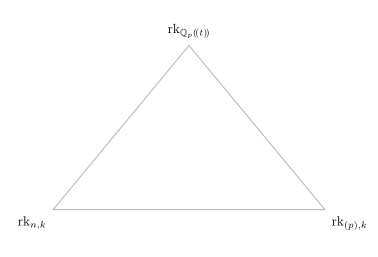
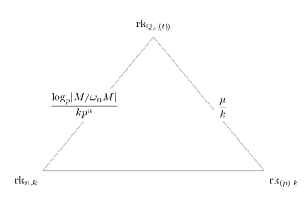
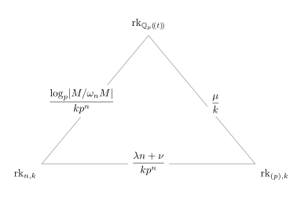

### How big is your matrix? {#title .title-manual}

::: {.title-tagline}
Sylvester rank functions
:::

::: {.title-meta-block}

::: {.author-name}
Iq Souza
:::

::: {.meta}
Seminario de Álgebra, Geometría y Topología

Universidad Complutense de Madrid

3 de noviembre, 2026
:::

:::

::: {.notes}
Goal: 00:30
:::

### What does rank measure? {#ordinary-rank}

::: {.notes}
Goal: 03:30
:::

::: {.incremental}
- For a matrix $A$ over a field $\mathbb{F}$: $$\operatorname{rk}_{\mathbb{F}}(A) = \dim_{\mathbb{F}} \operatorname{im}(A) = \text{pivots after Gaussian elim.} = \ldots$$
- Consider the matrix $A = \begin{pmatrix}1 & 2 & 3\\ 4 & 5 & 6\\ 7 & 8 & 9\end{pmatrix}$ over $\mathbb{Z}$.
- Over $\mathbb{Q}$, $A$ has rank $2$.
- $A \equiv \begin{pmatrix} 1 & 2 & 0\\ 1 & 2 & 0\\ 1 & 2 & 0\end{pmatrix}$ has rank $1$ over $\mathbb{F}_3$.
- For all other primes, $A$ has rank $2$ over $\mathbb{F}_p$.
:::

### Sylvester matrix rank functions {#sylvester-ranks}

::: {.notes}
Goal: 09:00
:::

:::: {.peek .fragment .incremental}
::: {.callout-note title="Definition    ($R$ associative, unital ring)"}
- A **Sylvester matrix rank function** on $R$ is a map $\operatorname{rk}\colon \operatorname{Mat}(R) \to \mathbb{R}_{\geq 0}$ that associates to each rectangular matrix $A$ over $R$ a non-negative real number $\operatorname{rk}(A)$ satisfying:
    - *(SMat1)* $\operatorname{rk}(0) = 0$, $\operatorname{rk}(1) = 1$.
    - *(SMat2)* $\operatorname{rk}(AB) \leq \min\{\operatorname{rk}(A)\,,\operatorname{rk}(B)\}$.
    - *(SMat3)* $\operatorname{rk}\begin{pmatrix}A & 0\\ 0 & B\end{pmatrix} = \operatorname{rk}(A) + \operatorname{rk}(B)$.
    - *(SMat4)* $\operatorname{rk}\begin{pmatrix}A & C\\ 0 & B\end{pmatrix} \geq \operatorname{rk}(A) + \operatorname{rk}(B)$.
:::
::::

:::: {.peek .fragment .incremental}
- Over a field $\mathbb{F}$, the usual rank $\operatorname{rk}_{\mathbb{F}}(A)$.
- Over the ring $\operatorname{Mat}_{n\times n}(\mathbb{F})$, $\operatorname{rk}(A) = \frac{\operatorname{rk}_{\mathbb{F}}(A)}{n}$.
- The previous examples come from $\mathbb{Z} \to \mathbb{Q}$ and $\mathbb{Z} \to \mathbb{F}_p$.
- There is $\operatorname{rk}$ on $\mathbb{Z}$ with $\operatorname{rk}(A) = 3/2$ *(foreshadowing...🕵️)*
- $\mathbb{P}(R)$: the set of **all** Sylvester matrix rank functions on $R$.
  - Pointwise convergence: $\operatorname{rk}_i \to \operatorname{rk}$ if $\operatorname{rk}_i(A) \to \operatorname{rk}(A)$ for any matrix $A$.
  - Compact 🥰
::::

### Laurent polynomials acting on $\mathbb{C}^N$ {#finite-shifts}

::: {.notes}
Goal: 12:30
:::

:::: {.peek .fragment}
::: {.callout-note title="$R = \mathbb{C}[t,t^{-1}]$"}
- For each $N \geq 1$, map $R \to \operatorname{Mat}_N(\mathbb{C})$ sending $t$ to a cyclic permutation: $$t \mapsto \begin{pmatrix}0 & 1 & 0 & \cdots & 0 & 0\\ 0 & 0 & 1 & \cdots & 0 & 0\\ \vdots & \vdots & \vdots & \ddots & \vdots \\ 0 & 0 & 0 & \cdots & 0 & 1 \\1 & 0 & 0 & \cdots & 0 & 0\end{pmatrix}\,.$$
:::
::::

:::: {.peek .fragment}
::: {.callout-tip title="The action on $\mathbb{C}^N$"}
- $t(z_1\,,z_2\,,\ldots\,,z_N) = (z_2\,,z_3\,,\ldots\,,z_1)$.
- Each element of $R$ gives a $\mathbb{C}$-linear map $\mathbb{C}^N \to \mathbb{C}^N$. Each $A(t) \in \operatorname{Mat}_{n\times m}(R)$ gives a block matrix $A_N \in \operatorname{Mat}_{nN\times mN}(\mathbb{C})$.
- We have a Sylvester rank functon $\operatorname{rk}_N$ on $R$ by taking $$\operatorname{rk}_N(A(t)) = \frac{\operatorname{rk}_{\mathbb{C}} A_N}{N}\,.$$
:::
::::

::: {.incremental}
- Take the $1\times 1$ matrix $x=t-1$ over $\mathbb{C}[t,t^{-1}]$.
    - $\ker x_N = \{(z_1\,,\ldots\,,z_N) \in \mathbb{C}^N\colon z_1 = z_2 = \cdots = z_N\}$.
    - Since $\ker x_N$ is $1$-dimensional, $\operatorname{rk}_{\mathbb{C}} x_N = N-1$.
    - $\operatorname{rk}_N(x) = \frac{N-1}{N}$. 
    - In particular, $\operatorname{rk}_N(x) \to 1$ as $N \to \infty$. 🤔
:::

### The finite Fourier transform {#finite-fourier}

::: {.notes}
Goal: 17:00
:::

Identify $\mathbb{C}^N$ with the vector space $\mathcal{P}_N$ all complex sequences $\{a_j\}_{j\geq 0}$ which are $N$-periodic: $a_j = a_{j+N}$ for all $j \geq 0$.

:::: {.peek .fragment .incremental}
::: {.callout-note title="Fourier transform"}
- The sequences $a_j^{(k)} = e^{\frac{2\pi ikj}{N}}$ for $k \in \{0\,,1\,,\ldots\,,N-1\}$ form a basis of $\mathcal{P}_N$.
- In this basis, $t_N$ is diagonal, with $N$ eigenvalues $\zeta_N^k = e^{\frac{2\pi ik}{N}}$.
- $\operatorname{rk}_N(A(t))$ is an average over roots of unity: $$\operatorname{rk}_N(A(t)) = \frac{1}{N}\sum_{k=0}^{N-1} \operatorname{rk}_{\mathbb{C}} A(\zeta_N^k)\,.$$
:::
::::

### Rank over the field of fractions {#generic-rank}

::: {.notes}
Goal: 21:00
:::

$R = \mathbb{C}[t,t^{-1}]$ has a field of fractions $\mathbb{C}(t)$, rational functions in $t$. 

::: {.incremental}
- $\operatorname{rk}_{\mathbb{C}(t)}(A(t)) = j$ if $j$ is the size of the largest square submatrix $B(t)$ of $A(t)$ such that $\det B(t) \neq 0$ identically.
- $\det B(t)$ has only finitely many zeroes in $\mathbb{C}^\times$, say $M$ of them.
$$\operatorname{rk}_N(A(t)) \geq \operatorname{rk}_N(B(t)) = \frac{1}{N} \sum_{k=0}^{N-1} \operatorname{rk}_{\mathbb{C}} B(\zeta_N^k) \geq \frac{j(N-M)}{N}\,.$$
- $\operatorname{rk}_N(A(t)) \leq j$ for all $N$ since minors of size $j+1$ vanish identically.
- We have $\operatorname{rk}_N \to \operatorname{rk}_{\mathbb{C}(t)}$ as $N \to \infty$!
:::

### The REAL Fourier transform {#von-neumann-rank}

::: {.notes}
Goal: 26:00
:::

:::: {.peek .fragment}
::: {.callout-note title="$L^2$-integrable functions on the circle"}
- $\ell^2(\mathbb{Z}) = \left\{(a_j)_{j \in \mathbb{Z}} \colon a_j \in \mathbb{C}\,, \sum_{j \in \mathbb{Z}} |a_j|^2 < \infty\right\}\,.$
- The *(inverse)* Fourier transform $\mathcal{F}\colon \ell^2(\mathbb{Z}) \to L^2(S^1)$ is given by $$\mathcal{F}((a_j)_{j \in \mathbb{Z}}) = \sum_{j \in \mathbb{Z}} a_jz^{-j}\,.$$
- If $T$ is the shift $(a_j) \mapsto (a_{j+1})$ in $\ell^2(\mathbb{Z})$, then $$\mathcal{F}(T(a_j)_{j \in \mathbb{Z}}) = z\mathcal{F}((a_j)_{j \in \mathbb{Z}})$$  corresponds to multiplication by $z$ in $L^2(S^1)$.
:::
::::

:::: {.peek .fragment}
::: {.callout-important title="von Neumann rank"}
- The map $t \mapsto z$ gives a ring map $R = \mathbb{C}[t,t^{-1}] \to L^\infty(S^1)$.
- A matrix $A(t) \in \operatorname{Mat}_{n\times m}(R)$ acts pointwise as matrix multiplication by $A(z)$ on $L^2(S^1)^m$.
- Integration is a rank function: $$\operatorname{rk}_{S^1}(A(t)) = \frac{1}{2\pi} \int_0^{2\pi} \operatorname{rk}_{\mathbb{C}}(A(e^{i\theta}))d\theta\,.$$
- $\operatorname{rk}_{\mathbb{C}(t)} = \operatorname{rk}_{S^1}$!
:::
::::

::: {.incremental}
- $$\lim_{N \to \infty} \operatorname{rk}_N = \operatorname{rk}_{S^1} = \operatorname{rk}_{\mathbb{C}(t)}$$
- $$\mathbb{C}[t,t^{-1}] \simeq \mathbb{C}[\mathbb{Z}]\,,\quad \mathbb{C}^N \simeq \mathbb{C}[\mathbb{Z}/N\mathbb{Z}]\,.$$
- So what we have really proved is an approximation statement for the group algebra of $\mathbb{Z}$. What about other group algebras?
:::

### Residually finite groups {#group-rings}

::: {.notes}
Goal: 29:00
:::

:::: {.peek .fragment}
::: {.callout-note title="Definition"}
- A group $G$ is **residually finite** if for every $1 \neq g \in G$ there exists a finite index normal subgroup $N \unlhd G$ not containing $g$.
- Equivalently, the intersection of all finite index normal subgroups of $G$ is $\{1\}$.
:::
::::

:::: {.peek .fragment}
::: {.callout-tip title="Ranks from finite quotients"}
- The group algebra $\mathbb{C}[G] = \{\sum_{g \in G} a_gg\colon a_g \in \mathbb{C}\text{, almost all }0\}$.
- For $N \unlhd G$ of finite index $(G\colon N)$, $\mathbb{C}[G/N]$ is finite dimensional. Each matrix $A \in \operatorname{Mat}_{n\times m}(\mathbb{C}[G])$ gives a matrix $A_N \in \operatorname{Mat}_{n(G\colon N)\times m(G\colon N)}(\mathbb{C})$.
- $\operatorname{rk}_N(A) = \frac{1}{(G\colon N)} \operatorname{rk}_{\mathbb{C}}(A_N)$ is a Sylvester rank function.
:::
::::

### Residually finite groups, continued {#luck-approximation}

::: {.notes}
Goal: 32:30
:::

:::: {.peek .fragment}
::: {.callout-note title="$\ell^2(G)$"}
- $\ell^2(G) = \left\{\sum_{g \in G} a_gg\colon \sum_{g \in G} |a_g|^2 < \infty\right\}$
- $\mathbb{C}[G]$ acts on the left as bounded operators in $\ell^2(G)$.
- There is a tracial $*$-algebra $\mathcal{N}(G)$ with $\mathbb{C}[G] \leq \mathcal{N}(G) \leq \mathcal{B}(\ell^2(G))$.
- As over $\mathbb{Z}$, the trace of a projection in $\mathcal{N}(G)$ gives a rank function $\operatorname{rk}_{\ell^2} \in \mathbb{P}(\mathbb{C}[G])$.
:::
::::

:::: {.peek .fragment}
::: {.callout-important title="Lück approximation"}
- Let $G$ be a residually finite group and $\cdots < N_2 < N_1 < G$ be a chain of finite index normal subgroups with $\bigcap N_i = \{1\}$. Then $$\lim_{i \to \infty} \operatorname{rk}_{N_i} = \operatorname{rk}_{\ell^2}\,.$$
- W. Lück *(1994)* for matrices over $\mathbb{Q}[G]$.
- Dodziuk–Linnell–Mathai–Schick–Yates *(2003)* for $\overline{\mathbb{Q}}[G]$.
- A. Jaikin-Zapirain *(2019)* for $\mathbb{C}[G]$.
:::
::::

### Back to $\mathbb{Z}$ {#arithmetic-rank}

::: {.notes}
Goal: 36:00
:::

:::: {.peek .fragment}
::: {.callout-note title="Ranks through $\log$ size"}
- On $\mathbb{Z}$, we already saw $\operatorname{rk}_{\mathbb{Q}}$ and $\operatorname{rk}_{\mathbb{F}_p}$.
- Fix a prime $p$ and a positive integer $k$. For $A \in \operatorname{Mat}(\mathbb{Z})$, define
$$\operatorname{rk}_{p^k}(A) = \frac{\log_p |\operatorname{im}(A \pmod{p^k})|}{k}\,.$$
- Each $\operatorname{rk}_{p^k}(A)$ is a Sylvester matrix rank function over $\mathbb{Z}$.
:::
::::

:::: {.peek .fragment}
::: {.callout-tip title="Examples"}
- We have $\operatorname{rk}_p = \operatorname{rk}_{\mathbb{F}_p}$.
- $\operatorname{rk}_9\begin{pmatrix} 1 & 2 & 3\\ 4 & 5 & 6\\ 7 & 8 & 9\end{pmatrix} = 3/2$.
- Taking a $1\times 1$-matrix $n \in \mathbb{Z}$, $\operatorname{rk}_{p^k}(n) = \frac{\max\{0,k-v_p(n)\}}{k}$.
- In general, for $p$ fixed, $\operatorname{rk}_{p^k} \to \operatorname{rk}_{\mathbb{Q}}$ as $k \to \infty$.
- The family $\{\operatorname{rk}_{p^k}\colon p\text{ prime,} k\geq 1\}$ sees prime factorizations!🔥
:::
::::

### Application: class numbers {#class-numbers}

::: {.notes}
Goal: 41:30
:::

:::: {.peek .fragment}
::: {.callout-note title="Ideal class group ($F$ number field, $\mathcal{O}_F$ its ring of integers)"}
- A fractional ideal $I$ is a finitely generated $\mathcal{O}_F$-submodule of $F$.
- A principal fractional ideal is $x\mathcal{O}_F$ for non-zero $x \in F$.
- The **ideal class group** of $F$ is the quotient $$\mathrm{Cl}(F) = \frac{\text{nonzero fractional ideals}}{\text{principal fractional ideals}}\,.$$
- It is always **finite.** Its order $h(F) = |\mathrm{Cl}(F)|$ is the **class number**.
:::
::::

:::: {.peek .fragment}
::: {.callout-tip title="Growth of $h(F)$"}
- $h(F) = 1$ if and only if $\mathcal{O}_F$ is a PID.
- Given a tower $F = F_0 \subset F_1 \subset F_2\subset\cdots$ of number fields, how does $h(F_i)$ grow as a function of $i$? (🤑)
:::
::::

:::: {.peek .fragment}
::: {.callout-important title="Iwasawa's growth formula *(1959)*"}
- Let $p$ be a prime number and $F = F_0 \subset F_1 \subset F_2 \subset \cdots$ be a tower of number fields such that $\operatorname{Gal}(F_n/F) \simeq \mathbb{Z}/p^n\mathbb{Z}$. Let $p^{e_n}$ be the largest power of $p$ dividing $h(F_n)$. There are  integer constants $\mu$, $\lambda$ and $\nu$ such that $$e_n = \mu p^n + \lambda n + \nu\quad (n >\!>0)\,.$$
:::
::::

### The Iwasawa algebra {#iwasawa-rank-triangle-1}

::: {.notes}
Goal: 45:00
:::

::: {.incremental .iwasawa-spaced}
- If $L = \bigcup F_i$, then $\operatorname{Gal}(L/F) \simeq \mathbb{Z}_p$.
- $\Lambda = \mathbb{Z}_p[\![\operatorname{Gal}(L/F)]\!] = \varprojlim \mathbb{Z}_p[\mathbb{Z}/p^n\mathbb{Z}] \simeq \mathbb{Z}_p[\![t]\!]$
- If $\omega_n = (t+1)^{p^n}-1$, then $\Lambda/(\omega_n) \simeq \mathbb{Z}_p[\mathbb{Z}/p^n\mathbb{Z}]$.
- The inverse limit $X = \varprojlim \mathrm{Cl}(F_n)(p)$ is naturally a $\Lambda$-module.
:::

### Ranks on the Iwasawa algebra {#iwasawa-rank-triangle-2}

::: {.notes}
Goal: 49:30
:::

:::: {.peek .fragment}
::: {.callout-important title="Iwasawa rank triangle"}
- $\operatorname{rk}_{\mathbb{Q}_p(\!(t)\!)} \in \mathbb{P}(\Lambda)$ since $\mathbb{Z}_p[\![t]\!] \subset \mathbb{Q}_p(\!(t)\!)$.
- For $A \in \operatorname{Mat}(\Lambda)$, $n \geq 0$ and $k \geq 1$, $$\operatorname{rk}_{n,k}(A) = \frac{\log_p|\operatorname{im}(A) \pmod{(p^k,\omega_n)}|}{kp^n}\,.$$
- $\Lambda_{(p)}$ is a DVR. For $A \in \operatorname{Mat}_{r\times s}(\Lambda)$ and $k \geq 1$, $$\operatorname{rk}_{(p),k}(A) = \frac{\mathrm{len}_{\Lambda_{(p)}}(A(\Lambda_{(p)}/(p^k))^s)}{k}\,.$$
:::
::::

:::: {.peek .fragment}
::: {.callout-tip title="Convergence inside $\mathbb{P}(\Lambda)$"}
- On $\mathbb{P}(\Lambda)$:
  - $\operatorname{rk}_{(p),k} \to \operatorname{rk}_{\mathbb{Q}_p(\!(t)\!)}$ as $k \to \infty$
  - $\operatorname{rk}_{n,k} \to \operatorname{rk}_{(p),k}$ as $n \to \infty$
  - $\operatorname{rk}_{n,k} \to \operatorname{rk}_{\mathbb{Q}_p(\!(t)\!)}$ as $n\,, k \to \infty$.
:::
::::

### The Iwasawa rank triangle {#iwasawa-final}

::: {.notes}
Goal: 55:00
:::

::: {.iwasawa-final-setup}
Let $A\in\operatorname{Mat}_{r\times s}(\Lambda)$ and
$M=\operatorname{coker}(A)=\Lambda^r/A\Lambda^s$.
Assume $M$ is torsion and $M/\omega_nM$ is finite for $n\gg0$.
:::

:::: {.columns .iwasawa-final-columns}

::: {.column width="53%"}

:::: {.r-stack .triangle-stack}

::: {.triangle-stage}
{width=100%}
:::

::: {.triangle-stage .fragment data-fragment-index="1"}
{width=100%}
:::

::: {.triangle-stage .fragment data-fragment-index="2"}
{width=100%}
:::

::: {.triangle-stage .fragment data-fragment-index="3"}
{width=100%}
:::

::::

:::

::: {.column width="47%"}

::: {.hard-fragment .fragment .nonincremental data-fragment-index="4"}

*(S., 2026)* The triangle equality is

$$
\boxed{
\frac{\log_p|M/\omega_nM|}{kp^n}
=
\frac{\mu}{k}
+
\frac{\lambda n+\nu}{kp^n}
}
$$

:::

::: {.hard-fragment .fragment .nonincremental data-fragment-index="5"}

Equivalently,

$$
\boxed{
\log_p|M/\omega_nM|
=
\mu p^n+\lambda n+\nu
}
$$

For the Iwasawa module of the tower this becomes *(🤨)*

$$
\boxed{
 v_p\!\left(h(F_n)\right)
 =\mu p^n+\lambda n+\nu.
}
$$

:::

:::

::::

### Thank you {#thanks .thanks-slide}

::: {.thanks-body}

::: {.thanks-question}
Questions?
:::

::: {.thanks-reprise}
*How big is your matrix?*

Depends who you ask...
:::
