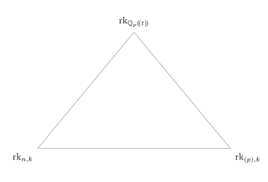
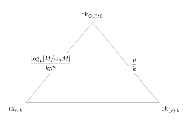
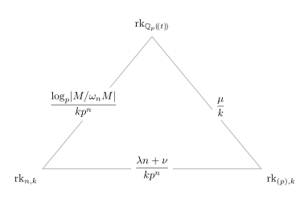

### How big is your matrix? {#title .title-manual}

::: {.title-tagline}
Sylvester rank functions
:::

::: {.title-meta-block}

::: {.author-name}
Iq Souza
:::

::: {.meta}
Seminario de Álgebra, Geometría y Topología

Universidad Complutense de Madrid

3 de noviembre, 2026
:::

:::

::: {.notes}
**GOAL: finish by 0:45**

**Highlight**
- "Rank is one of the first ways we learn to measure the size of a matrix."
- The question today: what can "rank" mean once the coefficients are not in a field?
- Roadmap in one sentence: one concrete example, a general approximation theorem, then an arithmetic application.

**Glance over**
- Do not describe the whole outline.
- Do not explain Sylvester ranks yet.

**Transition**
"Let me start with the situation where we all agree what rank means."
:::

<!-- OPENING AND RANK FUNCTIONS — approximately 12 minutes. -->

### What does rank measure? {#ordinary-rank}

::: {.notes}
**GOAL: finish by 2:00**

**Highlight**
- Over a field, several apparently different notions of size coincide.
- Point briefly to image dimension, row reduction, minors, factorization.
- The equivalence is what makes ordinary rank feel canonical.

**Glance over**
- Do NOT explain each characterization.
- No proof of equivalence.
- The factorization characterization can just be mentioned.

**Key sentence**
"Over a field there is one number answering all these questions. Over a general ring, these notions begin to separate."

**Transition**
"So already over the integers, which notion should we choose?"
:::

<!--
- Recall the equivalent descriptions of rank over a field.
- Work through one small matrix using two of these descriptions.
- Ask what it means to measure the size of a matrix over a general ring. -->

<!--:::: {.peek .fragment}-->

::: {.callout-note title="Over a field $\mathbb{F}$"}
 For $A \in \operatorname{Mat}_{n\times m}(\mathbb{F})$, the following are equal:

 - $\dim_{\mathbb{F}} \operatorname{im}(A)$ ($\operatorname{im}(A) = A\mathbb{F}^m$).
 - Largest $j$ such that $A \sim \begin{pmatrix}\operatorname{Id}_j & 0 \\ 0 & 0\end{pmatrix}$.
 - Largest $j$ such that $\det B \neq 0$ for a $j\times j$-submatrix $B$ of $A$.
 - Smallest $j$ such that $A = BC$ with $B \in \operatorname{Mat}_{n\times j}(\mathbb{F})$ and $C \in \operatorname{Mat}_{j \times m}(\mathbb{F})$.
:::

<!--::::-->

- What about general rings $R$? What should measure its size?

### An example over $\mathbb{Z}$ {#different-ranks}

::: {.notes}
**GOAL: finish by 3:00**

**Highlight**
- Same integer matrix, different answers after changing coefficients.
- Over Q: rank 2.
- Mod 3: rank 1.
- Mod every other prime: rank 2.

**Glance over**
- Do not perform row reduction.
- Do not prove the "all other primes" statement; the Smith normal form is diag(1,3,0) if asked.

**Key question**
"Which of these is the rank of the integer matrix? There is no reason to privilege only one."

**Transition**
"The approach I want to take is not to choose one rank, but to axiomatize what a reasonable rank should do."
:::

Consider the matrix $A = \begin{pmatrix}1 & 2 & 3\\ 4 & 5 & 6\\ 7 & 8 & 9\end{pmatrix}$ over $\mathbb{Z}$.

- Over $\mathbb{Q}$, $A \sim \begin{pmatrix}1 & 0 & 0\\0 & 1 & 0\\0 & 0 &0\end{pmatrix}$ has rank $2$.
- $A \equiv \begin{pmatrix} 1 & 2 & 0\\ 1 & 2 & 0\\ 1 & 2 & 0\end{pmatrix}$ has rank $1$ over $\mathbb{F}_3$.
- For all other primes, $A$ has rank $2$ over $\mathbb{F}_p$.

### Sylvester matrix rank functions {#sylvester-ranks}

::: {.notes}
**GOAL: finish by 4:45**

**Highlight**
Interpret the four axioms rather than reading them mechanically:
- SMat1: normalization.
- SMat2: composition cannot increase rank.
- SMat3: ranks add under direct sums.
- SMat4: block-triangular matrices contain at least the information of their diagonal blocks.

Emphasize:
- Values are allowed to be arbitrary non-negative real numbers.
- This is deliberately much more flexible than ordinary integer-valued rank.

**Glance over**
- No checking that ordinary rank satisfies the axioms.
- No consequences of the axioms.
- No module-rank formulation.

**Transition**
"Where do these things actually come from? The easiest source is ordinary linear algebra."
:::

::: {.callout-note title="Definition    ($R$ associative, unital ring)"}
A **Sylvester matrix rank function** on $R$ is a map $\operatorname{rk}\colon \operatorname{Mat}(R) \to \mathbb{R}_{\geq 0}$ that associates to each rectangular matrix $A$ over $R$ a non-negative real number $\operatorname{rk}(A)$ satisfying:

- *(SMat1)* $\operatorname{rk}(0) = 0$, $\operatorname{rk}(1) = 1$.
- *(SMat2)* $\operatorname{rk}(AB) \leq \min\{\operatorname{rk}(A)\,,\operatorname{rk}(B)\}$.
- *(SMat3)* $\operatorname{rk}\begin{pmatrix}A & 0\\ 0 & B\end{pmatrix} = \operatorname{rk}(A) + \operatorname{rk}(B)$.
- *(SMat4)* $\operatorname{rk}\begin{pmatrix}A & C\\ 0 & B\end{pmatrix} \geq \operatorname{rk}(A) + \operatorname{rk}(B)$.
:::

<!-- Definition and examples: https://arxiv.org/html/2012.15844v1 -->

### Examples {#representation-ranks}

::: {.notes}
**GOAL: finish by 6:45**

**Highlight**
- Ordinary rank over a field.
- Matrix algebras force normalization by 1/n.
- General principle: a representation R -> Mat_n(F) gives a rank function by normalized ordinary rank.
- This explains the Q- and F_p-ranks on Z.
- Foreshadow: there is a perfectly legitimate rank assigning our matrix 3/2.

Then introduce only the topology you need:
- P(R) = all rank functions.
- Convergence means pointwise convergence on every fixed matrix.
- Mention compactness in ONE sentence.

**Glance over**
- Do not discuss why P(R) is compact.
- Do not discuss extreme points or convex geometry.
- Do not expand the 3/2 example yet.

**Key sentence**
"For the rest of the talk, the basic question is: when a sequence of rank functions comes from larger and larger representations, does it converge, and what is its limit?"

**Transition**
"Let's answer that question completely for one ring."
:::

::: {.incremental}
- Over a field $\mathbb{F}$, the usual rank $\operatorname{rk}_{\mathbb{F}}(A)$.
- Over the ring $\operatorname{Mat}_{n\times n}(\mathbb{F})$, $\operatorname{rk}(A) = \frac{\operatorname{rk}_{\mathbb{F}}(A)}{n}$.
- The previous examples come from $\mathbb{Z} \to \mathbb{Q}$ and $\mathbb{Z} \to \mathbb{F}_p$.
- There is even a rank function on $\mathbb{Z}$ that would assign $A$ the value $3/2$. *(foreshadowing...🕵️)*
- $\mathbb{P}(R)$: the set of **all** Sylvester matrix rank functions on $R$.
  - Pointwise convergence: $\operatorname{rk}_i \to \operatorname{rk}$ if $\operatorname{rk}_i(A) \to \operatorname{rk}(A)$ for any matrix $A$.
  - Compact 🥰
:::

<!--
- Introduce normalized rank on $M_d(k)$ and explain the factor $1/d$.
- Pull rank back along a ring homomorphism $R\longrightarrow M_d(k)$.
- Check that an $m\times m$ identity matrix has rank $m$.
- Reinterpret the examples over $\mathbb{Z}$ in this language.-->

<!--
### Properties {#rank-properties}

::: {.callout-note title="Follows from *(SMat1)-(SMat4)*:"}
- If $A \in \operatorname{Mat}_{n\times m}(R)$, then $\operatorname{rk}(A) \leq n\,, m$.
- If $A \in \operatorname{GL}_n(R)$, then $\operatorname{rk}(A) = n$.
- If $A \in \operatorname{Mat}_{n\times m}(R)$, $U \in \operatorname{GL}_n(R)$ and $V \in \operatorname{GL}_m(R)$, then $$\operatorname{rk}(UAV) = \operatorname{rk}(A)\,.$$
- $\operatorname{rk}(\operatorname{Id}_n) = n$.
- If $B$ is a submatrix of $A$, then $\operatorname{rk}(B) \leq \operatorname{rk}(A)$.
::: -->

<!--
:::: {.peek .fragment}
::: {.callout-tip title="Examples"}
- Over a field $\mathbb{F}$, $\mathbb{P}(\mathbb{F}) = \{\operatorname{rk}_{\mathbb{F}}\}$, for $R = \operatorname{Mat}_n(\mathbb{F})$, $\mathbb{P}(R) = \{\frac{\operatorname{rk}_{\mathbb{F}}}{n}\}$.
- $\mathbb{P}(\mathbb{Z})$ has infinitely many extreme points.
- If $p_1 < p_2 < p_3 <...$ are the primes, then $\operatorname{rk}_{\mathbb{F}_{p_i}} \to \operatorname{rk}_{\mathbb{Q}}$ on $\mathbb{Z}$.
- *(A. Jaikin-Zapirain, D. López-Álvarez, 2020)* For $R$ a Dedekind domain (for example, a PID), extreme points of $\mathbb{P}(R)$ are classified.
:::
:::: -->

<!--
- Explain pointwise convergence: evaluate every rank on a fixed matrix.
- Show how to form convex combinations of rank functions.
- Mention compactness briefly and motivate looking for limits of ranks.-->

<!-- LAURENT POLYNOMIALS AND SHIFTS — approximately 20 minutes. -->

### Laurent polynomials acting on $\mathbb{C}^N$ {#finite-shifts}

::: {.notes}
**GOAL: finish by 9:15**

**Highlight**
- R = C[t,t^{-1}].
- Send t to the cyclic shift.
- A matrix A(t) becomes one large block matrix A_N.
- Normalize ordinary rank by N:
  rk_N(A) = rk_C(A_N)/N.

Explain WHY divide by N:
- the representation has dimension N;
- this keeps rk_N(1) = 1.

**Glance over**
- Do not read the cyclic permutation matrix entry-by-entry.
- Do not explain Laurent polynomials generally.
- One sentence is enough for how block substitution works.

**Transition**
"Before asking about arbitrary matrices, let's compute the simplest possible example."
:::

:::: {.peek .fragment}
::: {.callout-note title="$R = \mathbb{C}[t,t^{-1}]$"}
- For each $N \geq 1$, map $R \to \operatorname{Mat}_N(\mathbb{C})$ sending $t$ to a cyclic permutation: $$t \mapsto \begin{pmatrix}0 & 1 & 0 & \cdots & 0 & 0\\ 0 & 0 & 1 & \cdots & 0 & 0\\ \vdots & \vdots & \vdots & \ddots & \vdots \\ 0 & 0 & 0 & \cdots & 0 & 1 \\1 & 0 & 0 & \cdots & 0 & 0\end{pmatrix}\,.$$
:::
::::

:::: {.peek .fragment}
::: {.callout-tip title="The action on $\mathbb{C}^N$"}
- $t(z_1\,,z_2\,,\ldots\,,z_N) = (z_2\,,z_3\,,\ldots\,,z_1)$.
- Each element of $R$ gives a $\mathbb{C}$-linear map $\mathbb{C}^N \to \mathbb{C}^N$. Each $A(t) \in \operatorname{Mat}_{n\times m}(R)$ gives a block matrix $A_N \in \operatorname{Mat}_{nN\times mN}(\mathbb{C})$.
- We have a Sylvester rank functon $\operatorname{rk}_N$ on $R$ by taking $$\operatorname{rk}_N(A(t)) = \frac{\operatorname{rk}_{\mathbb{C}} A_N}{N}\,.$$
:::
::::

<!--
- Introduce $R=\mathbb{C}[t,t^{-1}]$ and the cyclic shift $S_N$ on $\mathbb{C}^N$.
- Draw the cycle and explain the representation $t\longmapsto S_N$.
- Explain how a matrix $A(t)$ becomes a block matrix $A(S_N)$.
- Define its normalized rank $\rho_N(A)$.
-->

### An example computation {#shift-kernel}

::: {.notes}
**GOAL: finish by 11:00**

**Highlight**
- Take x = t - 1.
- Kernel consists exactly of constant vectors.
- Therefore ordinary rank is N - 1.
- Normalized rank is 1 - 1/N -> 1.

Pause briefly at:
"Does rk_N itself converge as a rank function?"

**Glance over**
- No need to write a basis for the kernel.
- Do not add extra examples such as t^d - 1.

**Transition**
"To answer this for an arbitrary matrix, the right coordinates are Fourier coordinates."
:::

Consider the $1\times 1$ matrix $x = t-1$ in $\mathbb{C}[t,t^{-1}]$.

::: {.incremental}
- $\ker x_N = \{(z_1\,,\ldots\,,z_N) \in \mathbb{C}^N\colon z_1 = z_2 = \cdots = z_N\}$.
- Since $\ker x_N$ is $1$-dimensional, $\operatorname{rk}_{\mathbb{C}} x_N = N-1$.
- $\operatorname{rk}_N(x) = \frac{N-1}{N}$. 
- In particular, $\operatorname{rk}_N(x) \to 1$ as $N \to \infty$. Does $\operatorname{rk}_N$ converge? 🤔
:::

<!--
- Identify the kernel of $S_N-I$ as the constant vectors.
- Compute $\rho_N(t-1)=1-1/N$ and ask what happens as $N$ grows.
- If useful, compare $S_N^a-I$ by counting the cycles of the permutation. -->

### The finite Fourier transform {#finite-fourier}

::: {.notes}
**GOAL: finish by 14:00**

**Highlight**
This is an important slide — explain it.

1. Identify C^N with periodic sequences.
2. Fourier modes a_j^(k) form a basis.
3. The cyclic shift acts diagonally:
   eigenvalue zeta_N^k on the k-th mode.
4. Therefore a polynomial f(t_N) acts on that mode by f(zeta_N^k).
5. For a matrix A(t), Fourier transform produces N small blocks A(zeta_N^k).

Then emphasize the payoff:
rk_N(A) = (1/N) sum_k rk_C A(zeta_N^k).

**Key sentence**
"One huge nN-by-mN matrix has decomposed into N ordinary n-by-m matrices."

**Glance over**
- Do not discuss Fourier normalization conventions.
- Do not explain the DFT as signal processing.
- "Frequency" can be a one-word intuition, not a detour.

**Transition**
"Now this average has an obvious candidate for its limit: generic rank."
:::

Identify $\mathbb{C}^N$ with the vector space $\mathcal{P}_N$ all complex sequences $\{a_j\}_{j\geq 0}$ which are $N$-periodic: $a_j = a_{j+N}$ for all $j \geq 0$.

:::: {.peek .fragment .incremental}
::: {.callout-note title="Fourier transform"}
- The sequences $a_j^{(k)} = e^{\frac{2\pi ikj}{N}}$ for $k \in \{0\,,1\,,\ldots\,,N-1\}$ form a basis of $\mathcal{P}_N$.
- In this basis, $t_N$ is diagonal, with $N$ eigenvalues $\zeta_N^k = e^{\frac{2\pi ik}{N}}$.
- $\operatorname{rk}_N(A(t))$ is an average over roots of unity: $$\operatorname{rk}_N(A(t)) = \frac{1}{N}\sum_{k=0}^{N-1} \operatorname{rk}_{\mathbb{C}} A(\zeta_N^k)\,.$$
:::
::::

<!--- Diagonalize $S_N$ using the discrete Fourier basis.
- Identify the eigenvalues with the $N$th roots of unity.
- Express $\rho_N(A)$ as an average of the ranks of $A(\zeta)$.
- Explain how the cycle becomes a collection of frequencies.-->

### Rank over the field of fractions {#generic-rank}

::: {.notes}
**GOAL: finish by 18:00**

**Highlight**
THIS IS ONE OF THE TWO PROOFS TO ACTUALLY EXPLAIN.

Let j = rk_{C(t)} A.

- Some j-by-j minor B(t) has nonzero determinant.
- A nonzero Laurent polynomial has only finitely many zeros in C^*.
- Away from those finitely many bad points, B(z) has full rank j.
- Therefore almost all N-th roots contribute rank at least j.
- All (j+1)-minors vanish identically, so specialization never has rank > j.

Conclude:
rk_N(A) -> rk_{C(t)}(A).

**Glance over**
- Do not linger on the displayed inequality algebraically.
- The idea is "finitely many exceptional roots / N".
- No algebraic geometry language unless useful for the room.

**Key sentence**
"We have proved our first approximation theorem completely."

**Transition**
"But there is a second, apparently very different, way of producing a rank on the same ring."
:::

$R = \mathbb{C}[t,t^{-1}]$ has a field of fractions $\mathbb{C}(t)$, rational functions in $t$. 

::: {.incremental}
- $\operatorname{rk}_{\mathbb{C}(t)}(A(t)) = j$ if $j$ is the size of the largest square submatrix $B(t)$ of $A(t)$ such that $\det B(t) \neq 0$ identically.
- $\det B(t)$ has only finitely many zeroes in $\mathbb{C}^\times$, say $M$ of them.
$$\operatorname{rk}_N(A(t)) \geq \operatorname{rk}_N(B(t)) = \frac{1}{N} \sum_{k=0}^{N-1} \operatorname{rk}_{\mathbb{C}} B(\zeta_N^k) \geq \frac{j(N-M)}{N}\,.$$
- $\operatorname{rk}_N(A(t)) \leq j$ for all $N$ since minors of size $j+1$ vanish identically.
- We have $\operatorname{rk}_N \to \operatorname{rk}_{\mathbb{C}(t)}$ as $N \to \infty$!
:::

<!--- Introduce the usual rank of $A(t)$ over $\mathbb{C}(t)$.
- Interpret this as the generic rank of the evaluations $A(z)$.
- Use a nonzero maximal minor to isolate finitely many exceptional points.-->
<!--
### The infinite shift {#infinite-shift}

::: {.callout-tip title="$\ell^2(\mathbb{Z})$ and the shift operator $T$"}
- Consider now the Hilbert space $$\ell^2(\mathbb{Z}) = \left\{(a_i)_{i \in \mathbb{Z}} \colon a_i \in \mathbb{C}\,, \sum_{i \in \mathbb{Z}} |a_i|^2 < \infty\right\}\,.$$ 
- Let $\mathcal{B}(\ell^2(\mathbb{Z}))$ be its ring of bounded $\mathbb{C}$-linear operators.
- Let $T(a_i) = (b_i)_{i \in \mathbb{Z}}$, where $b_i = a_{i+1}$. Then $T \in \mathcal{B}(\ell^2(\mathbb{Z}))$.
:::-->

<!--
:::: {.peek .fragment}
::: {.callout-important title="Hilbert space operators"}
- We have a map $R \to \mathcal{B}(\ell^2(\mathbb{Z}))$ given by $t \mapsto T$.
- Any matrix $A(t) \in \operatorname{Mat}_{n\times m}(R)$ gives a bounded map $A(T)\colon \ell^2(\mathbb{Z})^m \to \ell^2(\mathbb{Z})^n$ between Hilbert spaces.
- The closure $\overline{A(T)\ell^2(\mathbb{Z})^m}$ of its image is a Hilbert subspace of $\ell^2(\mathbb{Z})^n$. Can we assign it a finite "dimension"?
:::
::::-->

<!--- Replace the finite cycle by the integer line.
- Let $t$ act by the bilateral shift on $\ell^2(\mathbb{Z})$.
- Explain how a Laurent polynomial matrix gives an operator between Hilbert spaces.
- Ask what should replace normalized dimension in this setting.-->

### The REAL Fourier transform {#von-neumann-rank}

::: {.notes}
**GOAL: finish by 23:00**

**Highlight**
- Replace the finite cycle by the infinite line Z.
- Fourier transform identifies l^2(Z) with L^2(S^1).
- Under this transform, the shift becomes multiplication by z.
- Thus A(t) acts pointwise as A(z).

Introduce the analytic rank:
rk_{S^1}(A)
= integral over S^1 of the ordinary pointwise rank.

Explain in one sentence why this is a von Neumann rank:
- pointwise project onto im A(z);
- trace = integral of the finite-dimensional trace = integral of pointwise rank.

Then:
- pointwise rank equals generic rank except at finitely many z;
- finite sets have Haar measure zero;
- hence rk_{S^1} = rk_{C(t)}.

**Glance over**
- Do not develop von Neumann algebras.
- Do not prove measurability of the image projection.
- Do not discuss closure of image unless someone asks.
- Do not prove that integration satisfies all Sylvester axioms.

**Key contrast**
"Finite Fourier transform gave averages over roots of unity; infinite Fourier transform gives an integral over the whole circle."

**Transition**
"Let me summarize what just happened before generalizing it."
:::

:::: {.peek .fragment}
::: {.callout-note title="$L^2$-integrable functions on the circle"}
- $\ell^2(\mathbb{Z}) = \left\{(a_j)_{j \in \mathbb{Z}} \colon a_j \in \mathbb{C}\,, \sum_{j \in \mathbb{Z}} |a_j|^2 < \infty\right\}\,.$
- The *(inverse)* Fourier transform $\mathcal{F}\colon \ell^2(\mathbb{Z}) \to L^2(S^1)$ is given by $$\mathcal{F}((a_j)_{j \in \mathbb{Z}}) = \sum_{j \in \mathbb{Z}} a_jz^{-j}\,.$$
- If $T$ is the shift $(a_j) \mapsto (a_{j+1})$ in $\ell^2(\mathbb{Z})$, then $$\mathcal{F}(T(a_j)_{j \in \mathbb{Z}}) = z\mathcal{F}((a_j)_{j \in \mathbb{Z}})$$  corresponds to multiplication by $z$ in $L^2(S^1)$.
:::
::::

<!--
:::: {.peek .fragment}
::: {.callout-tip title="The von Neumann algebra"}
- $L^\infty(S^1)$ is the ring of bounded functions on $S^1$. It acts on $L^2(S^1)$ as bounded operators.
- $L^\infty(S^1)$ has a trace: $$\operatorname{tr}(g) = \frac{1}{2\pi}\int_0^{2\pi}g(e^{i\theta})d\theta\,.$$
- Every $L^\infty(S^1)$-stable closed subspace $V$ of $L^2(S^1)^n$ has a projection $p_V\colon L^2(S^1)^n \to V$ in $\operatorname{Mat}_{n\times n}(L^\infty(S^1))$.
:::
:::: -->

:::: {.peek .fragment}
::: {.callout-important title="von Neumann rank"}
- The map $t \mapsto z$ gives a ring map $R = \mathbb{C}[t,t^{-1}] \to L^\infty(S^1)$.
- A matrix $A(t) \in \operatorname{Mat}_{n\times m}(R)$ acts pointwise as matrix multiplication by $A(z)$ on $L^2(S^1)^m$.
- Integration is a rank function: $$\operatorname{rk}_{S^1}(A(t)) = \frac{1}{2\pi} \int_0^{2\pi} \operatorname{rk}_{\mathbb{C}}(A(e^{i\theta}))d\theta\,.$$
- $\operatorname{rk}_{\mathbb{C}(t)} = \operatorname{rk}_{S^1}$!
:::
::::

<!--- Identify $\ell^2(\mathbb{Z})$ with $L^2(S^1)$ using the Fourier transform.
- Turn the shift into multiplication by the coordinate function $z$.
- Introduce $\mathcal{N}(\mathbb{Z})\cong L^\infty(S^1)$ and its trace.
- Describe matrix rank as the integral of the pointwise ranks of $A(z)$.-->

<!--
The circle is the Fourier dual of Z. The action being transformed is the
shift on l^2(Z). Use the closure of the image in defining operator rank.
Do not identify C(t) with a subring of L^infinity(S^1).
Reference: Anantharaman–Popa, An Introduction to II_1 Factors, Example 1.3.8.
https://www.math.ucla.edu/~popa/Books/IIunV15.pdf
-->
<!--
### The REAL Fourier transform, continued {#von-neumann-rank-2}

- For a matrix $A(t) \in \operatorname{Mat}_{n\times m}(R)$ with projection $p_A \in \operatorname{Mat}_{n\times n}(L^\infty(S^1))$, we have: $$\operatorname{rk}_{S^1}(A(t)) = \operatorname{tr}_n(p_A) = \frac{1}{2\pi}\int_0^{2\pi} \operatorname{rk}_{\mathbb{C}}(A(e^{i\theta})) d\theta\,.$$
- On $S^1$, $\operatorname{rk}_{\mathbb{C}}(A(z))$ is an almost-everywhere constant function of $z$, equal to $\operatorname{rk}_{\mathbb{C}(t)}(A(t))$.
- On $\mathbb{C}[t,t^{-1}]$, we have $\operatorname{rk}_{\mathbb{C}(t)} = \operatorname{rk}_{S^1}$!-->

### Summary so far {#three-ranks}

::: {.notes}
**GOAL: finish by 24:30**

**Highlight**
Point first to:
lim rk_N = rk_{S^1} = rk_{C(t)}.

Then reveal/reinterpret:
C[t,t^{-1}] = C[Z],
C^N = C[Z/NZ].

**Main sentence**
"So what looked like an exercise about Laurent polynomials was really an approximation theorem for the group algebra of Z."

**Glance over**
- Do not re-explain any of the three rank constructions.
- Do not repeat the proof.

**Transition**
"Now replace Z by an arbitrary residually finite group."
:::

- $$\lim_{N \to \infty} \operatorname{rk}_N = \operatorname{rk}_{S^1} = \operatorname{rk}_{\mathbb{C}(t)}$$
- $$\mathbb{C}[t,t^{-1}] \simeq \mathbb{C}[\mathbb{Z}]\,,\quad \mathbb{C}^N \simeq \mathbb{C}[\mathbb{Z}/N\mathbb{Z}]\,.$$
- So what we have really proved is an approximation statement for the group algebra of $\mathbb{Z}$. What about other group algebras?

<!--
:::: {.peek .fragment .incremental}
::: {.callout-warning title="Another viewpoint"}
- We can see $\mathbb{C}[t,t^{-1}]$ as the group ring $\mathbb{C}[\mathbb{Z}]$ where $\langle t \rangle \simeq \mathbb{Z}$.
- The action on $\mathbb{C}^N$ is equivalent to the action on $\mathbb{C}[\mathbb{Z}/N\mathbb{Z}]$.
- The groups $\mathbb{Z}/N\mathbb{Z}$ "approximate" $\mathbb{Z}$ as $N$ grows.
- The uniform measures in the sets $\{1\,,\zeta_N\,,\ldots\,,\zeta_N^{N-1}\}$ approximate the Haar measure in $S^1$ as $N$ grows.
- Is there an analogue for more general group rings?
:::
:::: -->

<!--- Put the finite cyclic ranks, fraction-field rank, and von Neumann rank side by side.
- State the equality of the two infinite constructions and the convergence of $\rho_N$.
- Give the proof by counting the finitely many exceptional evaluations.
- Ask how much of this picture survives for more general groups.-->

<!-- GENERAL GROUPS AND APPROXIMATION — approximately 7 minutes. -->

### Residually finite groups {#group-rings}

::: {.notes}
**GOAL: finish by 27:00**

**Highlight**
- Residually finite = finite quotients eventually detect every nontrivial element.
- We choose finite-index normal subgroups shrinking to 1.
- A matrix over C[G] acts on C[G/N].
- Normalize ordinary rank by [G:N].

Make the analogy explicit:
Z/NZ has simply been replaced by G/N.

**Glance over**
- Do not explain convolution.
- Do not list many examples of residually finite groups.
- Do not prove the equivalent definition.

**Transition**
"The finite side is now clear. What should replace the circle on the infinite side?"
:::

:::: {.peek .fragment}
::: {.callout-note title="Definition"}
- A group $G$ is **residually finite** if for every $1 \neq g \in G$ there exists a finite index normal subgroup $N \unlhd G$ not containing $g$.
- Equivalently, the intersection of all finite index normal subgroups of $G$ is $\{1\}$.
:::
::::

:::: {.peek .fragment}
::: {.callout-tip title="Ranks from finite quotients"}
- The group algebra $\mathbb{C}[G] = \{\sum_{g \in G} a_gg\colon a_g \in \mathbb{C}\text{, almost all }0\}$.
- For $N \unlhd G$ of finite index $(G\colon N)$, $\mathbb{C}[G/N]$ is finite dimensional. Each matrix $A \in \operatorname{Mat}_{n\times m}(\mathbb{C}[G])$ gives a matrix $A_N \in \operatorname{Mat}_{n(G\colon N)\times m(G\colon N)}(\mathbb{C})$.
- $\operatorname{rk}_N(A) = \frac{1}{(G\colon N)} \operatorname{rk}_{\mathbb{C}}(A_N)$ is a Sylvester rank function.
:::
::::

<!-- Explain group-ring elements as finite linear combinations of translations.
- Introduce residual finiteness and a nested separating chain of finite-index normal subgroups.
- Compare matrices acting on finite quotients with their action on $\ell^2(G)$.
- Explain the normalization by the size of each finite quotient.-->

### Residually finite groups, continued {#luck-approximation}

::: {.notes}
**GOAL: finish by 31:00**

**Highlight**
- C[G] acts on l^2(G).
- There is a canonical trace, so projections have a von Neumann dimension/rank.
- This is exactly the analogue of L^\infty(S^1) for G = Z.

Then state Lück approximation clearly:
rk_{N_i}(A) -> rk_{l^2}(A).

Pause after the formula.

**Interpretation**
"For Z we proved this with Fourier transform and zeros of polynomials. For a general group there is no diagonalization, but the same convergence survives."

**Glance over**
- Do not define N(G) carefully.
- Do not read all three historical attribution bullets.
- Say: "Lück proved the rational case; later work extends this to the complex coefficients used here."

**Transition**
"So rank functions can turn finite approximations into information about an infinite object. Now I want to change direction and show that they can also remember arithmetic torsion."
:::

:::: {.peek .fragment}
::: {.callout-note title="$\ell^2(G)$"}
- $\ell^2(G) = \left\{\sum_{g \in G} a_gg\colon \sum_{g \in G} |a_g|^2 < \infty\right\}$
- $\mathbb{C}[G]$ acts on the left as bounded operators in $\ell^2(G)$.
- There is a tracial $*$-algebra $\mathcal{N}(G)$ with $\mathbb{C}[G] \leq \mathcal{N}(G) \leq \mathcal{B}(\ell^2(G))$.
- As over $\mathbb{Z}$, the trace of a projection in $\mathcal{N}(G)$ gives a rank function $\operatorname{rk}_{\ell^2} \in \mathbb{P}(\mathbb{C}[G])$.
:::
::::

:::: {.peek .fragment}
::: {.callout-important title="Lück approximation"}
- Let $G$ be a residually finite group and $\cdots < N_2 < N_1 < G$ be a chain of finite index normal subgroups with $\bigcap N_i = \{1\}$. Then $$\lim_{i \to \infty} \operatorname{rk}_{N_i} = \operatorname{rk}_{\ell^2}\,.$$
- W. Lück *(1994)* for matrices over $\mathbb{Q}[G]$.
- Dodziuk–Linnell–Mathai–Schick–Yates *(2003)* for $\overline{\mathbb{Q}}[G]$.
- A. Jaikin-Zapirain *(2019)* for $\mathbb{C}[G]$.
:::
::::

<!--
- State the matrix-rank approximation theorem with its precise hypotheses.
- Explain the von Neumann rank appearing in the limit.
- Recover the cyclic-shift example when $G=\mathbb{Z}$.
- Explain what finite computations now tell us about an infinite group.
-->
<!--
Coefficient choice: the classical theorem is over Q[G]. If you state the
version over C[G], include the appropriate extension and attribution.
Use a nested finite-index normal chain with trivial intersection.
Sources:
https://link.springer.com/article/10.1007/BF01896404
https://andreijaikin.wordpress.com/2024/05/06/the-luck-approximation/
-->

<!--
### Hyperbolic 3-manifolds and representation ranks {#hyperbolic-optional visibility="hidden"}

- Introduce the fundamental group of a finite-volume hyperbolic 3-manifold.
- Describe the sequence of representations and its normalized rank functions.
- Insert the precise rank-approximation statement from the work with Lander.
- Compare approximation by these representations with approximation by finite quotients.

<!--
OPTIONAL: approximately 3–4 minutes. State the result in matrix-rank language.
Source: Guerrero Sánchez–Souza, Asymptotics of rational representations for
algebraic groups, https://arxiv.org/html/2405.17360v2
-->

<!-- ARITHMETIC AND IWASAWA THEORY — approximately 13 minutes. -->

### Back to $\mathbb{Z}$ {#arithmetic-rank}

::: {.notes}
**GOAL: finish by 34:00**

**Highlight**
- Return deliberately to the ring Z.
- Define rk_{p^k} using logarithmic size of the image modulo p^k.
- Explain why log is natural: direct sums multiply cardinalities, logarithms make them additive.

Then examples:
- k = 1 gives ordinary F_p-rank.
- For a scalar n, rank depends on v_p(n).
- CALLBACK: opening matrix has rk_9 = 3/2.

Say explicitly:
"This is the 3/2 I promised at the beginning."

Main conceptual point:
finite k retains p-adic torsion information; k -> infinity forgets it and returns rational rank.

**Glance over**
- Do not prove the Sylvester axioms.
- Do not compute the 3/2 from minors unless asked.
- The "sees prime factorizations" line can just be a closing remark.

**Transition**
"So these rank defects can measure the size of finite p-groups. Number theory has a very natural finite group whose size we would like to understand."
:::

:::: {.peek .fragment}
::: {.callout-note title="Ranks through $\log$ size"}
- On $\mathbb{Z}$, we already saw $\operatorname{rk}_{\mathbb{Q}}$ and $\operatorname{rk}_{\mathbb{F}_p}$.
- Fix a prime $p$ and a positive integer $k$. For $A \in \operatorname{Mat}(\mathbb{Z})$, define
$$\operatorname{rk}_{p^k}(A) = \frac{\log_p |\operatorname{im}(A \pmod{p^k})|}{k}\,.$$
- Each $\operatorname{rk}_{p^k}(A)$ is a Sylvester matrix rank function over $\mathbb{Z}$.
:::
::::

:::: {.peek .fragment}
::: {.callout-tip title="Examples"}
- We have $\operatorname{rk}_p = \operatorname{rk}_{\mathbb{F}_p}$.
- $\operatorname{rk}_9\begin{pmatrix} 1 & 2 & 3\\ 4 & 5 & 6\\ 7 & 8 & 9\end{pmatrix} = 3/2$.
- Taking a $1\times 1$-matrix $n \in \mathbb{Z}$, $\operatorname{rk}_{p^k}(n) = \frac{\max\{0,k-v_p(n)\}}{k}$.
- In general, for $p$ fixed, $\operatorname{rk}_{p^k} \to \operatorname{rk}_{\mathbb{Q}}$ as $k \to \infty$.
- The family $\{\operatorname{rk}_{p^k}\colon p\text{ prime,} k\geq 1\}$ sees prime factorizations!🔥
:::
::::

<!-- Motivate measuring a finite $p$-group by its logarithmic size.
- Introduce rank from normalized length over $\mathbb{Z}/p^k\mathbb{Z}$.
- Use multiplication by $p$ as the first example.
- Explain how a rank defect records the size of a cokernel.-->

<!--
Possible model: rho_{p,k}(A) = log_p |im(A mod p^k)| / k.
For an a-by-b matrix, log_p |coker(A mod p^k)| = k(a-rho_{p,k}(A)).
The precision k must be large enough to recover all the desired torsion.
-->

### Application: class numbers {#class-numbers}

::: {.notes}
**GOAL: finish by 36:00**

**Highlight**
- Class group = fractional ideals / principal ideals.
- It is finite.
- Its order h(F) is the class number.
- h(F)=1 means all ideals are principal / O_F is a PID.

Do NOT teach algebraic number theory here.

Question:
"Put the fields in a structured infinite tower. How does the p-part of h(F_n) grow?"

**Glance over**
- Fractional ideal definition in one sentence at most.
- No Minkowski theorem.
- No ideal factorization background.

**Transition**
"Iwasawa's theorem says that this growth is astonishingly rigid."
:::

Let $F$ be a number field, that is, a finite extension of $\mathbb{Q}$. Denote by $\mathcal{O}_F$ its ring of integers.

:::: {.peek .fragment}
::: {.callout-note title="Ideal class group"}
- A fractional ideal $I$ is a finitely generated $\mathcal{O}_F$-submodule of $F$.
- A principal fractional ideal is $x\mathcal{O}_F$ for non-zero $x \in F$.
- The **ideal class group** of $F$ is the quotient $$\mathrm{Cl}(F) = \frac{\text{nonzero fractional ideals}}{\text{principal fractional ideals}}\,.$$
- It is always **finite.** Its order $h(F) = |\mathrm{Cl}(F)|$ is the **class number**.
:::
::::

:::: {.peek .fragment}
::: {.callout-tip title="Growth of $h(F)$"}
- $h(F) = 1$ if and only if $\mathcal{O}_F$ is a PID.
- Given a tower $F = F_0 \subset F_1 \subset F_2\subset\cdots$ of number fields, how does $h(F_i)$ grow as a function of $i$? (🤑)
:::
::::

<!--- Explain the ideal class group and its order, the class number.
- Introduce a $\mathbb{Z}_p$-extension through its finite layers $K_n$.
- Focus on the $p$-part of the class number and its exponent $e_n$.
- Ask how $e_n$ grows with the level of the tower.-->

### Iwasawa's class number formula {#iwasawa-formula}

::: {.notes}
**GOAL: finish by 40:00**

**Highlight**
- Tower with Gal(F_n/F) = Z/p^n Z.
- e_n = v_p(h(F_n)).
- Eventually:
  e_n = mu p^n + lambda n + nu.
- mu, lambda >= 0; nu integer.

Pause to emphasize:
"An a priori complicated sequence of class groups eventually has only three growth scales."

Examples:
- Q: e_n = 0.
- 37 example: e_n = n+1 -> lambda term.
- Hubbard-Washington: e_n = 3^n - 1 -> mu term.

**Glance over**
- Do not explain why 37 is irregular.
- Do not construct the Hubbard-Washington tower.
- Do not discuss the cyclotomic mu=0 conjecture.

**Transition**
"Why should a formula of exactly this shape appear? The answer lives in another group algebra."
:::

:::: {.peek .fragment}
::: {.callout-important title="Iwasawa's growth formula *(1959)*"}
- Let $p$ be a prime number and $F = F_0 \subset F_1 \subset F_2 \subset \cdots$ be a tower of number fields such that $\operatorname{Gal}(F_n/F) \simeq \mathbb{Z}/p^n\mathbb{Z}$.
- Let $p^{e_n}$ be the largest power of $p$ dividing $h(F_n)$. There are  integer constants $\mu$, $\lambda$ and $\nu$ such that $$e_n = \mu p^n + \lambda n + \nu\quad (n >\!>0)\,.$$
:::
::::

:::: {.peek .fragment}
::: {.callout-tip title="Examples"}
- Over $\mathbb{Q}$, $e_n = 0$.
- $\exists$ tower over $\mathbb{Q}(\zeta_{37})$ with $p = 37$, $e_n = n+1$ for $n >\!> 0$.
- *(D. Hubbard, L.C. Washington, 2017)* $\exists$ tower over $\mathbb{Q}(\zeta_3,\sqrt[3]{10})$ with $p=3$, $e_n = 3^n-1$ for $n >\!> 0$.
:::
::::

<!-- State the eventual formula $e_n=\mu p^n+\lambda n+\nu$.
- Explain the meaning of the parameters and the phrase "for all sufficiently large $n$".
- Distinguish the exponential, linear, and constant contributions.
- Explain why such a precise growth law is striking.-->

<!--
Classical statement: mu, lambda are nonnegative integers; nu is an integer.
Reference: https://math.ucla.edu/~sharifi/notes/iwasawa-ch03.html
-->

### The Iwasawa algebra {#iwasawa-rank-triangle-1}

::: {.notes}
**GOAL: finish by 43:00**

**Highlight**
- L/F has Galois group Z_p.
- Iwasawa algebra:
  Lambda = Z_p[[Z_p]] ~= Z_p[[t]].
- Finite layer:
  Lambda/(omega_n) ~= Z_p[Z/p^n Z].
- X = inverse limit of p-primary class groups is naturally a Lambda-module.

Make the structural analogy explicit:

Earlier:
C[Z/NZ] approximated C[Z].

Now:
Z_p[Z/p^n Z] are the finite quotients of the completed group algebra Lambda.

**Glance over**
- Do not explain completed group rings in detail.
- Do not prove the isomorphism with Z_p[[t]].
- Do not discuss norm maps beyond saying they define the inverse limit.

**Transition**
"And just as before, these different realizations of the same ring give different rank functions."
:::

- If $L = \bigcup F_i$, then $\operatorname{Gal}(L/F) \simeq \mathbb{Z}_p$.
- $\Lambda = \mathbb{Z}_p[\![\operatorname{Gal}(L/F)]\!] = \varprojlim \mathbb{Z}_p[\mathbb{Z}/p^n\mathbb{Z}] \simeq \mathbb{Z}_p[\![t]\!]$
- If $\omega_n = (t+1)^{p^n}-1$, then $\Lambda/(\omega_n) \simeq \mathbb{Z}_p[\mathbb{Z}/p^n\mathbb{Z}]$.
- The inverse limit $X = \varprojlim \mathrm{Cl}(F_n)(p)$ is naturally a $\Lambda$-module.

### Ranks on the Iwasawa algebra {#iwasawa-rank-triangle-2}

::: {.notes}
**GOAL: finish by 47:30**

**Highlight**
Give each rank a JOB before discussing formulas:

1. rk_{n,k}:
   finite level n + finite p-adic precision k.

2. rk_{(p),k}:
   infinite/tower level + finite p-adic precision k.

3. rk_{Q_p((t))}:
   generic rank.

Point at the formulas, but do not read every symbol.

Then emphasize convergence:
- n -> infinity: finite-layer rank -> localized rank.
- k -> infinity: localized rank -> generic rank.
- both -> infinity: finite rank -> generic rank.

If useful, say:
"This is the arithmetic analogue of the rank_N -> generic rank picture we saw for Laurent polynomials."

**Glance over**
- Do not teach localization.
- "Lambda_(p) is a DVR" is enough.
- Do not derive the normalized length formula.

**Important**
The displayed rk_{(p),k} is IMAGE length / k, not cokernel length.

**Transition**
"The convergence itself is nice, but the real information is in how far apart these three ranks are."
:::

:::: {.peek .fragment}
::: {.callout-important title="Iwasawa rank triangle"}
- $\operatorname{rk}_{\mathbb{Q}_p(\!(t)\!)} \in \mathbb{P}(\Lambda)$ where $\mathbb{Q}_p(\!(t)\!) = \operatorname{Frac}(\Lambda)$.
- For $A \in \operatorname{Mat}(\Lambda)$, $n \geq 0$ and $k \geq 1$, $$\operatorname{rk}_{n,k}(A) = \frac{\log_p|\operatorname{im}(A) \pmod{(p^k,\omega_n)}|}{kp^n}\,.$$
- $\Lambda_{(p)}$ is a DVR. For $A \in \operatorname{Mat}_{r\times s}(\Lambda)$ and $k \geq 1$, $$\operatorname{rk}_{(p),k}(A) = \frac{\mathrm{len}_{\Lambda_{(p)}}(A(\Lambda_{(p)}/(p^k))^s)}{k}\,.$$
:::
::::

:::: {.peek .fragment}
::: {.callout-tip title="Convergence inside $\mathbb{P}(\Lambda)$"}
- On $\mathbb{P}(\Lambda)$:
  - $\operatorname{rk}_{(p),k} \to \operatorname{rk}_{\mathbb{Q}_p(\!(t)\!)}$ as $k \to \infty$
  - $\operatorname{rk}_{n,k} \to \operatorname{rk}_{(p),k}$ as $n \to \infty$
  - $\operatorname{rk}_{n,k} \to \operatorname{rk}_{\mathbb{Q}_p(\!(t)\!)}$ as $n\,, k \to \infty$.
:::
::::

<!-- Insert the precise formulation from your paper on Iwasawa's class-number formula.
- Identify the rings, ranks, and arithmetic quantities involved.
- Explain the main mechanism, including what detects the lower-order terms.
- Connect the argument to the finite-approximation picture developed earlier.-->
### The Iwasawa rank triangle {#iwasawa-final}

::: {.notes}
**GOAL: finish by 53:30**

THIS IS THE PAYOFF — DO NOT RUSH.

**Setup**
- Fix A and M = coker(A).
- M torsion; M/omega_n M finite for n >> 0.
- For a fixed matrix A, define mentally:
  d_A(rho,sigma) = |rho(A)-sigma(A)|.
  No need to put this on the slide unless helpful.

**Reveal 1: first side**
log_p |M/omega_n M| / (k p^n).

Say:
"This is the finite-level quantity we ultimately care about."

**Reveal 2: second side**
mu/k.

Say:
"The distance from the localized rank to generic rank is exactly the mu contribution."

**Reveal 3: third side**
(lambda n + nu)/(k p^n).

Say:
"The remaining side contains precisely the lower-order lambda and nu terms."

**Reveal 4: triangle equality**
Pause.

Main sentence:
"The three ranks form a degenerate triangle, and its triangle equality is exactly the growth formula."

**Reveal 5**
Multiply by k p^n:
log_p |M/omega_n M|
= mu p^n + lambda n + nu.

Then arithmetic payoff:
In the clean Iwasawa-module situation where
X/omega_n X identifies with Cl(F_n)(p),
this becomes
v_p(h(F_n)) = mu p^n + lambda n + nu.

If you want complete accuracy, say orally:
"In general there is a small additional comparison between coinvariants of X and the finite-level class groups; the same rank-function argument survives."

**Final conceptual sentence**
"We started by asking how big a matrix is. The point is that there need not be one answer: the distances between different answers can themselves encode arithmetic information."

STOP. Let the formula sit.

**Glance over**
- Do not prove the structure theorem for Lambda-modules.
- Do not explain the general ramification correction.
- Do not rederive the three ranks.
:::

::: {.iwasawa-final-setup}
Let $A\in\operatorname{Mat}_{r\times s}(\Lambda)$ and
$M=\operatorname{coker}(A)=\Lambda^r/A\Lambda^s$.
Assume $M$ is torsion and $M/\omega_nM$ is finite for $n\gg0$.
:::

:::: {.columns .iwasawa-final-columns}

::: {.column width="53%"}

:::: {.r-stack .triangle-stack}

::: {.triangle-stage}
{width=100%}
:::

::: {.triangle-stage .fragment data-fragment-index="1"}
{width=100%}
:::

::: {.triangle-stage .fragment data-fragment-index="2"}
{width=100%}
:::

::: {.triangle-stage .fragment data-fragment-index="3"}
{width=100%}
:::

::::

:::

::: {.column width="47%"}

::: {.hard-fragment .fragment .nonincremental data-fragment-index="4"}

*(S., 2026)* The triangle equality is

$$
\boxed{
\frac{\log_p|M/\omega_nM|}{kp^n}
=
\frac{\mu}{k}
+
\frac{\lambda n+\nu}{kp^n}
}
$$

:::

::: {.hard-fragment .fragment .nonincremental data-fragment-index="5"}

Equivalently,

$$
\boxed{
\log_p|M/\omega_nM|
=
\mu p^n+\lambda n+\nu
}
$$

For the Iwasawa module of the tower this becomes *(🤨)*

$$
\boxed{
 v_p\!\left(h(F_n)\right)
 =\mu p^n+\lambda n+\nu.
}
$$

:::

:::

::::

<!--
### Rank functions and class number growth {#iwasawa-ranks}

::: {.callout-important title="Pseudo-metrics and torsion-modules *(S., 2026)*"}
Let $A \in \operatorname{Mat}_{r\times s}(\Lambda)$ and $M = \Lambda^r/A\Lambda^s$. Assume $M$ is torsion and $M/\omega_n M$ is finite for large $n$. There are integers $\mu$, $\lambda$, $\nu$ such that for large enough $n$ and large enough $k$ (depending on $n$) we have $$\underbrace{\frac{\log_p |M/\omega_n M|}{kp^n}}_{d_A(\operatorname{rk}_{n,k},\operatorname{rk}_{\mathbb{Q}_p(\!(t)\!)})} = \underbrace{\frac{\mu}{k}}_{d_A(\operatorname{rk}_{(p),k}, \operatorname{rk}_{\mathbb{Q}_p(\!(t)\!)})} + \underbrace{\frac{\lambda n + \nu}{kp^n}}_{d_A(\operatorname{rk}_{n,k},\operatorname{rk}_{(p),k})}\,.$$:::

- There is a matrix $A$ over $\Lambda$ such that $M/\omega_n M$ is isomorphic to the $p$-primary part of $\operatorname{Cl}(F_n)$. It recovers Iwasawa's formula.--> 

### Thank you {#thanks .thanks-slide}

::: {.thanks-body}

::: {.thanks-question}
Questions?
:::

::: {.thanks-reprise}
*How big is your matrix?*

Depends who you ask...
:::

:::
::: {.notes}
**GOAL: finish by 54:00**

Say only:
"Thank you."

If useful, leave the previous triangle/result visible while taking questions rather than lingering on the Thanks slide.

**HARD STOP**
You have ~6 minutes of cushion in a one-hour slot.
:::